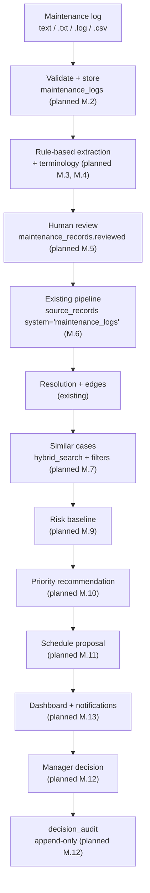
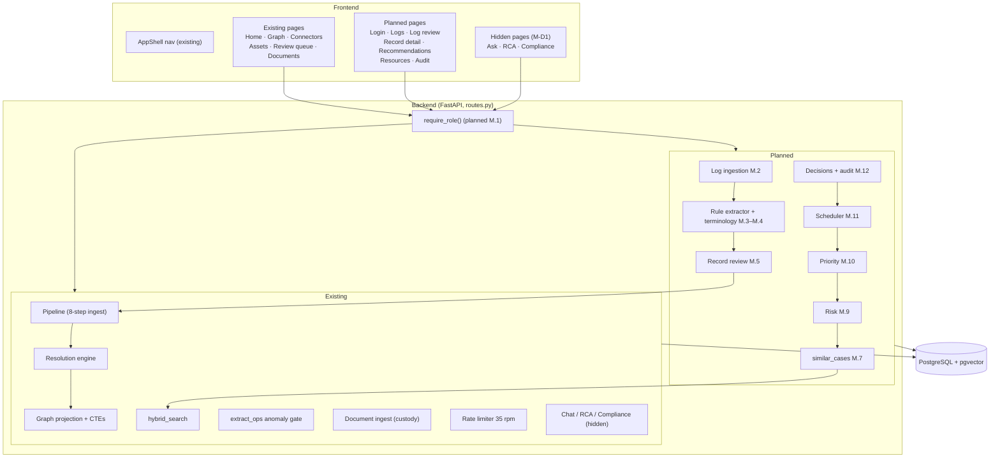
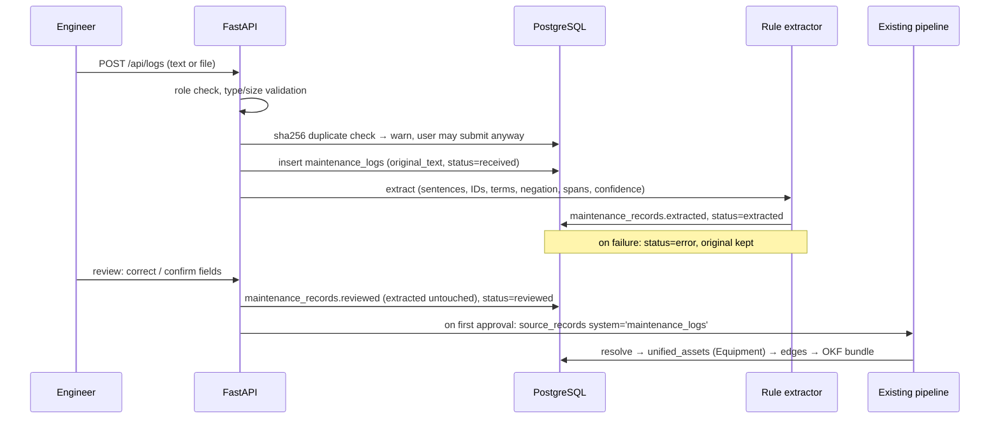
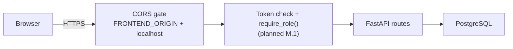

# atlogs — System Architecture

> Code-level entry points: [`AGENTS.md`](../AGENTS.md) §1. Data model:
> [`memory.md`](memory.md). Status of planned parts: [`tasks.md`](tasks.md).
> **Existing** = in the code today. **Planned** = task M.x, not built.

---

## 1. Principles

1. **One database.** PostgreSQL + pgvector holds logs, records, vectors, FTS,
   the relationship graph (`edges`, recursive CTEs), resources and audit.
   No Neo4j, FAISS or OR-Tools (decision M-D4).
2. **The system recommends; a human decides.** Risk, priority and schedule are
   proposals. Only a manager's decision changes their status, and every decision
   is appended to an audit log.
3. **Evidence, not certainty.** Every extracted field keeps its source span;
   every recommendation keeps its factors and similar cases; risk is labelled
   *uncalibrated* until evaluated.
4. **Deterministic first.** Rule-based extraction, SQL, and code formulas run
   before (or instead of) any LLM call. Everything core works without an LLM key.

---

## 2. Core flow (spec §1) mapped to tiers

| Tier | Technology | atlogs responsibilities |
|------|-----------|------------------------|
| Frontend | Vite + React 19 + TS, Tailwind v4, shadcn/ui | Login, log upload, review, record detail, recommendations, schedule, audit, dashboard (planned); graph, assets, connectors, review queue, documents (existing) |
| Backend | Python 3.13, FastAPI, SSE | Auth + role checks, log validation, extraction, scoring, scheduling (planned); ingest pipeline, resolution, graph, retrieval (existing) |
| Database | PostgreSQL + pgvector + tsvector | All storage — one database |
| LLM / AI | NVIDIA NIM (Nemotron) | Optional: embeddings, rerank, filling empty extraction fields. Shared 35 rpm limiter |
| Documents | Docling, pypdfium2 fallback | PDF parse with chain-of-custody (existing) |

---

## 3. Components

---

## 4. Maintenance-log ingestion path (planned M.2–M.6)

Re-correction after first approval is open decision M-Q1.

The existing inputs stay: JSON connectors / `POST /api/ingest` and PDF upload
(`/api/documents/*`) both feed the same pipeline:

1. store new `(system, record_id)` only → 2. load corpus → 3–4. schema discovery
+ normalisation → 5. embed records lacking vectors → 6. full-corpus resolve
(honours `manual_decisions`) → 7. graph projection → 8. operational edges
(anomaly gate) → OKF bundles.

Ingestion is incremental (only new record IDs) and accumulative (whole-corpus
re-resolve; one source never clobbers another).

---

## 5. Relationships (existing `edges` table)

| Layer | Relations | Status |
|-------|-----------|--------|
| Physical | `HAS_SOURCE_RECORD`, `HAS_SERIAL`, `HAS_MAC`, `HAS_IDENTIFIER`, `LOCATED_IN` | Existing |
| Operational | `HAS_FAILURE`, `HAS_WORK_ORDER`, `HAS_SENSOR`, `DEPENDS_ON`, `SUBJECT_TO`, `MAY_BE_CAUSED_BY`, `VIOLATES` | Existing |
| Maintenance case | `HAS_COMPONENT` (asset → component), `EXHIBITED` (component → symptom), `ADDRESSED_BY` (symptom → action); the case itself is the `HAS_WORK_ORDER` / `HAS_FAILURE` edge and `sr:` record | M.6 |

Node IDs are prefixed (`asset:`, `sr:`, `fm:`, `cf:`, `rule:`, `wo:`, `sensor:`, `comp:<asset>:<name>`, `sym:`, `act:`).
Traversal uses recursive CTEs with cycle guard and depth limit.

---

## 6. Similar-case retrieval

Existing `hybrid_search(conn, query, k)`: dense over `source_records` + FTS +
dense over `okf_documents`, fused by RRF (k=60), optional NVIDIA rerank, best
OKF bundle. Query text only; no filters.

Planned `similar_cases(record_id or text, filters)` (M.7) wraps it with
equipment / component / date filters, a "no relevant match" threshold, and an
FTS-only path when no key is set. Results always link to the source log.

---

## 7. LLM use

| Tier | Model | atlogs use |
|------|-------|-----------|
| Embed | `nemotron-3-embed-1b` (2048-d) | Record and OKF vectors (existing) |
| Rerank | `llama-nemotron-rerank-1b-v2` | Optional rerank in retrieval (existing) |
| Extract / Fast | `nvidia-nemotron-nano-9b-v2` | Anomaly tie-break (existing); fill empty extraction fields (planned, optional) |
| Reasoning | `nemotron-3-ultra-550b-a55b` | Hidden chat only |

All calls go through one 35-rpm token bucket with bounded retry. No model
computes risk, priority, schedule or decisions.

---

## 8. Security and trust boundaries

- **Today:** no authentication; every endpoint is open. Do not expose a
  deployment with real data until M.1 lands.
- **Planned (M-D2):** `users` table, `hashlib.scrypt` password hashes,
  HMAC-signed token with expiry, `require_role()` on every route. Roles:
  `engineer` (logs, review, search), `manager` (+ decisions, schedules),
  `admin` (+ users, resources, criticality).
- CORS: `FRONTEND_ORIGIN` + localhost regex (existing).
- Prompt-injection guard: regex + gatekeeper LLM on hidden chat (existing).
- Secrets in `backend/.env` only, git-ignored.

---

## 9. Hidden features (M-D1)

Ask Copilot (`/ask`, `POST /api/chat`), RCA (`/workflows/rca`, `POST /api/rca`,
`GET /api/graph/rca`) and Compliance (`/workflows/compliance`,
`POST /api/compliance`, `GET /api/graph/compliance`) are retained and
hidden. Planned: removed from the nav in M.0; reachable by URL;
code and tests unchanged. `workflow_runs` stays limited to `rca` / `compliance`.

---

## 10. Deployment

Config exists, none verified for atlogs:

| Piece | Config |
|-------|--------|
| Backend image | `Dockerfile` (full Docling), `Dockerfile.slim` (text-only PDFs, `DOCLING_ENABLED=false`); both `uvicorn --workers 1` on `$PORT` (default 7860) |
| Hosts | `render.yaml`, `railway.toml`, `deploy/docker-compose.yml` + `deploy/Caddyfile` (VM + Caddy) |
| Frontend | `frontend/vercel.json` (SPA rewrite) |
| Database | Supabase Postgres with pgvector; apply `schema.sql` by hand |

**Single worker everywhere** — the in-memory job registry and DB pool assume one
process.
