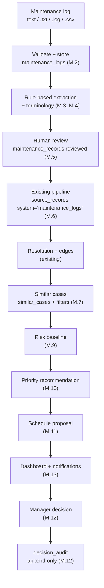
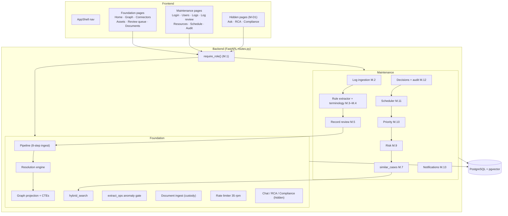
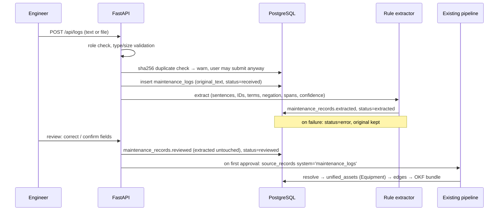
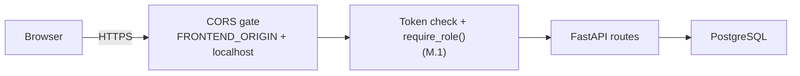

# atlogs — System Architecture

> Code-level entry points: [`AGENTS.md`](../AGENTS.md) §1. Data model:
> [`memory.md`](memory.md). Task status: [`tasks.md`](tasks.md).
> Everything below is in the code on branch `feat/atlogs-core`. Task status and evidence: [`tasks.md`](tasks.md); the end-to-end walk of spec §6 is `backend/tests/test_e2e_spec6.py`. Nothing is deployed.

---

## 1. Principles

1. **One database.** PostgreSQL + pgvector holds logs, records, vectors, FTS,
   the relationship graph (`edges`, recursive CTEs), resources and audit.
   No Neo4j, FAISS or OR-Tools (decision M-D4).
2. **The system recommends; a human decides.** Risk, priority and schedule are
   proposals. Only a manager's decision changes their status, and every decision
   is appended to an audit log.
3. **Evidence, not certainty.** Every extracted field keeps its source span;
   every recommendation keeps its factors and similar cases; risk is labelled
   *uncalibrated* until evaluated.
4. **Deterministic first.** Rule-based extraction, SQL, and code formulas run
   before (or instead of) any LLM call. Everything core works without an LLM key.

---

## 2. Core flow (spec §1) mapped to tiers

| Tier | Technology | atlogs responsibilities |
|------|-----------|------------------------|
| Frontend | Vite + React 19 + TS, Tailwind v4, shadcn/ui | Login, users (admin), logs, log review + similar cases + risk + priority + decision, resources, schedule, audit, dashboard and notification badge; graph, assets, connectors, review queue, documents |
| Backend | Python 3.12+, FastAPI, SSE | Auth + role checks, log validation, extraction, scoring, scheduling, decisions, notifications; ingest pipeline, resolution, graph, retrieval |
| Database | PostgreSQL + pgvector + tsvector | All storage — one database |
| LLM / AI | NVIDIA NIM (Nemotron) | Optional: embeddings, rerank, filling empty extraction fields. Shared 35 rpm limiter |
| Documents | Docling, pypdfium2 fallback | PDF parse with chain-of-custody (existing) |

---

## 3. Components

---

## 4. Maintenance-log ingestion path (M.2–M.6)

Re-correction after first approval (M-D6): only `maintenance_records.reviewed` changes; the `source_records` row and its `raw_json` are never rewritten, and every rebuild overlays the current reviewed values (`logs.projection_raw`). A correction therefore reaches the graph at the next rebuild.

The existing inputs stay: JSON connectors / `POST /api/ingest` and PDF upload
(`/api/documents/*`) both feed the same pipeline:

1. store new `(system, record_id)` only → 2. load corpus → 3–4. schema discovery
+ normalisation → 5. embed records lacking vectors → 6. full-corpus resolve
(honours `manual_decisions`) → 7. graph projection → 8. operational edges
(anomaly gate) → OKF bundles.

Ingestion is incremental (only new record IDs) and accumulative (whole-corpus
re-resolve; one source never clobbers another).

---

## 5. Relationships (existing `edges` table)

| Layer | Relations | Status |
|-------|-----------|--------|
| Physical | `HAS_SOURCE_RECORD`, `HAS_SERIAL`, `HAS_MAC`, `HAS_IDENTIFIER`, `LOCATED_IN` | Existing |
| Operational | `HAS_FAILURE`, `HAS_WORK_ORDER`, `HAS_SENSOR`, `DEPENDS_ON`, `SUBJECT_TO`, `MAY_BE_CAUSED_BY`, `VIOLATES` | Existing |
| Maintenance case | `HAS_COMPONENT` (asset → component), `EXHIBITED` (component → symptom), `ADDRESSED_BY` (symptom → action); the case itself is the `HAS_WORK_ORDER` / `HAS_FAILURE` edge and `sr:` record | M.6 |

Node IDs are prefixed (`asset:`, `sr:`, `fm:`, `cf:`, `rule:`, `wo:`, `sensor:`, `comp:<asset>:<name>`, `sym:`, `act:`).
Traversal uses recursive CTEs with cycle guard and depth limit.

---

## 6. Similar-case retrieval

`hybrid_search(conn, query, k)`: dense over `source_records` + FTS +
dense over `okf_documents`, fused by RRF (k=60), optional NVIDIA rerank, best
OKF bundle. Query text only; no filters.

`similar_cases(conn, text, filters, k)` (M.7, `workflows/retrieval.py`) is restricted to `maintenance_logs` records and supports equipment / component / ISO date-range filters on current values (reviewed, else extracted). FTS relevance is a Dice word overlap (`SIMILAR_MIN_FTS` 0.25); pgvector is fused with `_rrf_fuse` only when embeddings work (`SIMILAR_MIN_VECTOR` 0.62), otherwise FTS-only. Below threshold it returns an explicit "no relevant match" reason. Both thresholds are uncalibrated. Each match carries `log_id`, a `/logs/<id>` link, a citation and scores. Routes: `GET /api/records/{log_id}/similar` (the log itself excluded), `POST /api/similar`.

---

## 7. LLM use

| Tier | Model | atlogs use |
|------|-------|-----------|
| Embed | `nemotron-3-embed-1b` (2048-d) | Record and OKF vectors (existing) |
| Rerank | `llama-nemotron-rerank-1b-v2` | Optional rerank in retrieval (existing) |
| Extract / Fast | `nvidia-nemotron-nano-9b-v2` | Anomaly tie-break (existing); fill empty extraction fields (only with a key; value must appear verbatim in the log) |
| Reasoning | `nemotron-3-ultra-550b-a55b` | Hidden chat only |

All calls go through one 35-rpm token bucket with bounded retry. No model
computes risk, priority, schedule or decisions.

---

## 8. Security and trust boundaries

- **Auth (M-D2):** `users` table, `hashlib.scrypt` password hashes, HMAC-signed bearer token (8 h expiry, `AUTH_SECRET`; the API refuses to start without it), router-level `require_role()` on every route except `GET /api/health` and login. Roles: `engineer` (logs, review, search, risk/priority runs), `manager` (decisions, schedule, resources, criticality, audit), `admin` (everything, plus users, terminology, connector delete, `documents/ingest-path`). Managers cannot edit review fields. The server enforces roles; hiding buttons in the UI is cosmetic.
- **Open gaps:** no rate limit on login, no token revocation, no password reset. Do not expose a deployment with real data before these are reviewed.
- CORS: `FRONTEND_ORIGIN` + localhost regex (existing).
- Prompt-injection guard: regex + gatekeeper LLM on hidden chat (existing).
- Secrets in `backend/.env` only, git-ignored.

---

## 9. Hidden features (M-D1)

Ask Copilot (`/ask`, `POST /api/chat`), RCA (`/workflows/rca`, `POST /api/rca`,
`GET /api/graph/rca`) and Compliance (`/workflows/compliance`,
`POST /api/compliance`, `GET /api/graph/compliance`) are retained and
hidden. Removed from the nav and the Workflows hub (M.0); reachable by URL;
code and tests unchanged. `workflow_runs` stays limited to `rca` / `compliance`.

---

## 10. Deployment

Config exists, none verified for atlogs:

| Piece | Config |
|-------|--------|
| Backend image | `Dockerfile` (full Docling), `Dockerfile.slim` (text-only PDFs, `DOCLING_ENABLED=false`); both `uvicorn --workers 1` on `$PORT` (default 7860) |
| Hosts | `render.yaml`, `railway.toml`, `deploy/docker-compose.yml` + `deploy/Caddyfile` (VM + Caddy) |
| Frontend | `frontend/vercel.json` (SPA rewrite) |
| Database | Supabase Postgres with pgvector; apply `schema.sql` by hand |

**Single worker everywhere** — the in-memory job registry and DB pool assume one
process.

---

## 11. Risk, priority, schedule, decision, notifications

| Stage | Code | Behaviour |
|-------|------|-----------|
| Risk (M.9) | `engine/risk.py` (pure), `services/risk.py` | Weighted baseline `risk-v0-uncalibrated`: recurrence 30, recent incidents 20, criticality 25, similar-case adverse rate 25; category cut-offs 34/67; `insufficient_evidence` when fewer than 3 history records on the equipment or criticality unknown. Stored insert-only in `risk_assessments` |
| Priority (M.10) | `engine/priority.py`, `services/priority.py` | Documented point policy (`rules.md` §4.1) gives P1-P4 plus an explanation list; stored `pending` in `recommendations`. Urgency words are negation-aware |
| Schedule (M.11) | `engine/schedule.py`, `services/schedule.py` | Greedy: priority order, earliest free window of a technician with the skill, one unit per part; unplaceable items become conflicts (`skill`/`part`/`availability`), priority never lowered. A proposal is a stored row; nothing is booked and stock is not written back |
| Decision (M.12) | `services/decision.py` | Manager/admin approve / modify / reject; status update and `decision_audit` insert in one transaction; only `pending` can be decided (409 otherwise); a DB trigger blocks UPDATE/DELETE/TRUNCATE on `decision_audit` |
| Notifications (M.13) | `services/notifications.py` | Derived query per role, no table (M-D7), no read state |

Routes: `POST/GET /api/records/{log_id}/risk|priority`, `POST /api/recommendations/{id}/decision`, `GET /api/records/{log_id}/decisions`, `GET /api/audit`, `POST /api/schedule/propose`, `GET /api/schedule/proposal`, `GET /api/notifications`, `GET /api/overview`.
