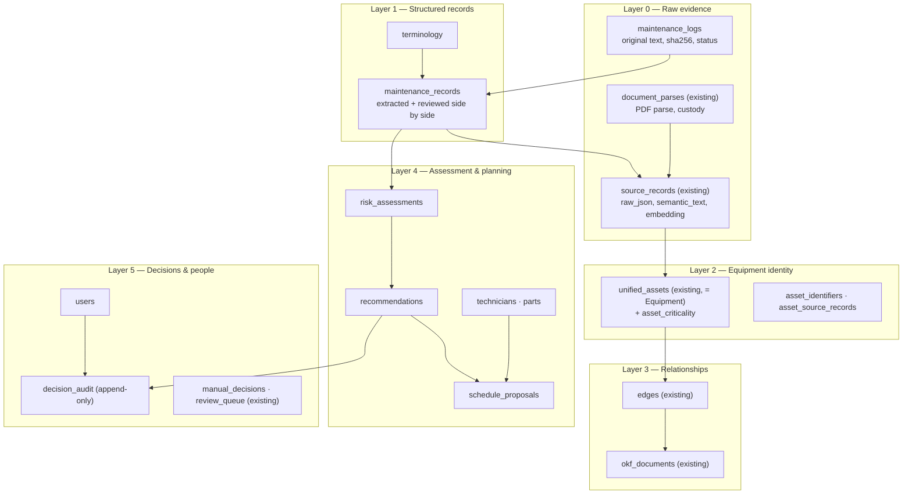
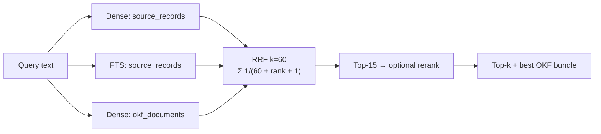
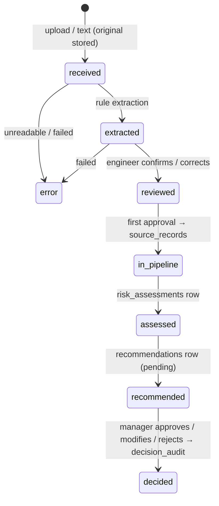

# atlogs — Data & Knowledge Model

> How atlogs stores raw evidence, processed records, recommendations and
> decisions. All tables live in one PostgreSQL database, defined in
> `backend/app/db/schema.sql` (applied by hand). Every table below is in
> schema.sql on `feat/atlogs-core`; the data-model summary is also in
> [`tasks.md`](tasks.md).

---

## 1. Layers



Spec §8 stores map: Raw logs → `maintenance_logs`; Structured records →
`maintenance_records`; Historical cases → `source_records` + `okf_documents`;
Equipment → `unified_assets`; Resources → `technicians`, `parts`; Risk →
`risk_assessments`; Recommendations / schedules → `recommendations`,
`schedule_proposals`; Audit → `decision_audit`; Terminology → `terminology`.

---

## 2. Maintenance tables (additive)

| Table | Key columns | Rules |
|-------|-------------|-------|
| `users` | email unique, password_hash, role (`engineer`/`manager`/`admin`), active | scrypt hash; never store plain passwords |
| `maintenance_logs` | sha256 (indexed, not unique), filename, original_text, submitted_by, status (`received`/`extracted`/`reviewed`/`error`), error | `original_text` never modified |
| `maintenance_records` | log_id FK, `extracted` jsonb (value, span, confidence, needs_review per field), `reviewed` jsonb, reviewed_by, reviewed_at, unified_id | Reviewed values stored **beside** extracted, never over them |
| `terminology` | term, canonical, kind (component/symptom/action/abbrev) | Seeded (e.g. brg → bearing) |
| `risk_assessments` | log_id FK, score, category, factors/features/input_refs jsonb, method_version, insufficient_evidence, created_by | Insert-only; labelled *uncalibrated*; `input_refs` lists the log ids and criticality used |
| `recommendations` | record_id FK, risk_id FK, priority, explanation jsonb, status (`pending`/`approved`/`modified`/`rejected`) | Status changes only via a decision |
| `asset_criticality` | (concept, lower(value)) PK, level low/medium/high | Keyed by asset identifier, not `unified_id`, so it survives the per-ingest rebuild; no row = `unknown` |
| `technicians`, `parts` | skills[], availability windows (jsonb); stock on hand | Manager/admin-entered, start empty (M-D8) |
| `component_defaults` | component PK, skill, duration_min, parts[] | Manager-editable; seeded with 6 components |
| `schedule_proposals` | horizon_start/end, assignments jsonb, conflicts jsonb, created_by | One row per run over all pending recommendations; conflicts kept, priority not lowered |
| `decision_audit` | recommendation_id FK, action, original jsonb, final jsonb, user_id, comment, created_at | **Append-only**: no update, no delete |

Criticality is not a column on `unified_assets` (that table is rebuilt every ingest); `GET /api/assets` joins `asset_criticality` through `asset_identifiers`. A reviewed record
enters the existing pipeline as a `source_records` row with
`system = 'maintenance_logs'` so resolution, `edges` and `hybrid_search` work
unchanged. Traceability chain: `decision_audit` → `recommendations` →
`risk_assessments` → `maintenance_records` → `maintenance_logs`.

---

## 3. Existing tables (15)

| Table | Purpose |
|-------|---------|
| `source_systems`, `source_records` | Every ingested record, `raw_json` untouched, deduped by `(system, record_id)`, 2048-d embedding computed lazily |
| `discovered_fields` | Per-system schema discovery (field → concept) |
| `unified_assets`, `asset_identifiers`, `asset_source_records` | Resolved identity (used as Equipment) |
| `edges` | Physical + operational relationship graph |
| `review_queue`, `manual_decisions` | Entity merge/separate review; durable human decisions applied on every re-resolve |
| `connectors` | JSON connector configs (manual payload or API) |
| `okf_documents` | Per-asset markdown bundle with citations, embedding, tsvector, `body_hash` |
| `document_parses`, `doc_extractions` | PDF parse saved before extraction (custody), sha256 dedupe, status `parsed`/`processed`/`error` |
| `operational_extractions` | Cached event extraction per record |
| `workflow_runs` | Hidden RCA/compliance history; `kind` CHECK-limited to `rca`/`compliance` |

The existing `review_queue` is for entity merges only. Field-level review of
extracted log values is `maintenance_records.reviewed`.

---

## 4. Entity resolution (existing)

Pairwise evidence from shared identifiers (validated by standards-derived
regexes) and embedding similarity, merged with union-find, strongest edge first.

```
confidence = min(1.0, base × redundancy × conflict_penalty)
```

- `redundancy` = 1.0 / 1.05 / 1.08 by distinct signal count (+0.03 for anchor+embedding)
- `conflict_penalty` = 0.40 (strong ID clash) / 0.80 (medium)

| Band | Threshold | Action |
|------|-----------|--------|
| Auto-merge | ≥ 0.95 | Merged |
| Suggest | 0.80 – 0.95 | Suggested to a human |
| Review | 0.60 – 0.80 | Review queue |
| Apart | < 0.60 | Separate |

---

## 5. Retrieval (existing, reused by `similar_cases`, M.7)



Fusion is deterministic. `similar_cases` adds equipment / component / date filters on current record values, a no-match threshold and an FTS-only fallback (see `architecture.md` §6).

---

## 6. Anomaly gate (existing)

`extract_ops.py` classifies records with a deterministic vocabulary first
(fail / leak / alarm → anomaly; completed / nominal / within tolerance →
benign); the LLM is only a tie-breaker. It has **no negation handling** today
("no leak found" is classified anomaly). Log extraction (`engine/log_extract.py`) is negation-aware on its own; the gate itself stays as-is (M-D3).

---

## 7. Caching (existing)

| Cache | Key | Invalidation |
|-------|-----|-------------|
| Record embeddings | `source_records.id` | New records only |
| Document extractions | `sha256` | Content change |
| Operational extractions | `record_id` | Content change |
| OKF bundles | `body_hash` | Body change |

---

## 8. Lifecycle of a maintenance log



`maintenance_logs.status` only holds `received`, `extracted`, `reviewed` and `error`. `in_pipeline`, `assessed`, `recommended` and `decided` are not stored; they are read from the existence of `source_records`, `risk_assessments`, `recommendations` and `decision_audit` rows. A failure at any step leaves the original log and earlier rows intact.
